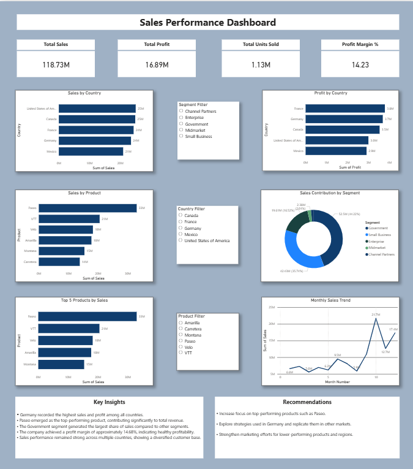

# Global Superstore Sales Analysis & Dashboard

## Project Overview

This project focuses on analysing the Global Superstore dataset using Python and developing a dashboard to present meaningful business insights.

I completed this project as part of my **Data Analytics Internship at BeeSkilled**. During the internship, we were assigned four tasks each week. For the fourth task, I was provided with a dataset and instructions to perform data analysis and develop a dashboard.

Based on the given instructions, I explored the dataset, performed data cleaning and analysis, created visualisations, and developed a dashboard to present important business information.

## Project Objectives

- Analyse the Global Superstore dataset using Python.
- Understand sales, profit, and order performance.
- Identify sales trends across different categories and regions.
- Analyse customer and product performance.
- Create meaningful data visualisations.
- Present important findings through a dashboard.
- Practise data analysis and data visualisation using Python.

## Technologies and Libraries Used

- **Python:** Main programming language used for data analysis.
- **Jupyter Notebook:** Environment used for writing and executing Python code.
- **Pandas:** Used for data cleaning, manipulation, and analysis.
- **NumPy:** Used for numerical operations and calculations.
- **Matplotlib:** Used for creating charts and graphs.
- **Seaborn:** Used for statistical data visualisation.
- **Cycler:** Used for managing colour cycles in Matplotlib visualisations.

## Work Performed

1. Explored and understood the provided Global Superstore dataset.
2. Loaded and examined the sample dataset using Python.
3. Performed data cleaning and preparation.
4. Used Pandas and NumPy for data manipulation and analysis.
5. Analysed sales and business performance patterns.
6. Created data visualisations using Matplotlib and Seaborn.
7. Developed a dashboard to present important findings.
8. Documented the project work and analysis in a report.

## Key Analysis Areas

- **Sales Analysis:** Understanding sales performance.
- **Profit Analysis:** Analysing profit across different categories and regions.
- **Category Analysis:** Comparing the performance of product categories.
- **Regional Analysis:** Understanding sales performance across regions.
- **Customer Analysis:** Exploring customer-related sales patterns.
- **Order and Return Analysis:** Examining order and return information available in the dataset.

## Dashboard Features

- Visual representation of sales and business performance.
- Charts and graphs for presenting analytical findings.
- Data visualisation using Python libraries.
- Dashboard designed to make business information easier to understand.

## Dashboard Preview

The following dashboard was developed using Power BI to present the key findings from the Global Superstore sales analysis.

**Power BI Dashboard:** [Download the Power BI Dashboard](https://github.com/Explorer239/global-superstore-sales-dashboard/blob/main/global%20superstore%20sales%20dashboard/Global_Superstore_Dashboard.pbix)

## Project Files

This repository contains the following project materials:

- Jupyter Notebook containing the Python code and analysis.
- Sample dataset used for the project.
- Dashboard developed as part of the analysis.
- Project report documenting the work.

## Key Learning Outcomes

- Gained practical experience in Python-based data analysis.
- Improved understanding of data cleaning and data manipulation.
- Learned to work with Pandas and NumPy.
- Practised creating visualisations using Matplotlib and Seaborn.
- Improved understanding of dashboard development.
- Learned how to communicate data insights through visualisations and reports.

## Internship Information

- **Internship Provider:** BeeSkilled
- **Internship Domain:** Data Analytics
- **Project:** Global Superstore Sales Analysis & Dashboard
- **Task:** Fourth assigned task during the internship.

## Conclusion

This project helped me understand how raw business data can be analysed and converted into meaningful insights using Python. It improved my practical understanding of data cleaning, data analysis, data visualisation, and dashboard development.

---

*This project was completed for learning and internship purposes.*
